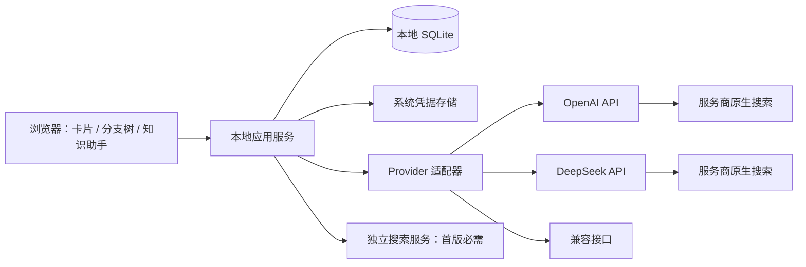

# Know Know 技术方案与决策清单

版本：1.0 · 2026-09-05  
对应需求：[产品功能说明书](./PRODUCT_SPEC.md)。本文是拟实施方案，不是已完成实现的说明。

1.0 的开发、联调与测试由接手团队承担，职责和交付要求见 [开发与测试交接说明](./DEVELOPMENT_HANDOFF.md)。本文中的“开发方”指接手团队；技术组合为建议，团队可评估等效实现并记录决策。

## 1. 已确定的方向

用户已选择：**第一版个人本机使用，通过浏览器访问。**

因此建议采用浏览器前端、本地应用服务、本地数据库的结构。1.0 针对用户当前的 macOS 环境，不搭建登录、云数据库、多租户或公网部署。多用户登录与用户数据隔离在 [1.1 规划](../1.1/PRODUCT_SPEC.md) 中定义，不提前加入 1.0。跨平台与桌面安装包以后另行评估。



模型、搜索提供商会收到请求所需的内容。所谓本地保存，指应用的数据主副本在本机，不意味着请求不会离开设备。

## 2. 哪些需要用户拍板

判断原则：影响使用方式、额外账户或费用、知识完整性和体验的取舍由用户决定；实现库、目录结构、接口组织及可逆的工程细节由开发方确定。

| 决策 | 当前状态 | 建议 | 对实现的影响 |
| --- | --- | --- | --- |
| D01 使用方式 | **已确认：本机个人版** | 浏览器访问本地服务 | 不做账号、云同步和多人权限。 |
| D02 联网覆盖范围 | **已确认：首版增加独立搜索服务** | 独立搜索作为兼容模型的通用路径；支持时也可接入原生搜索 | 增加搜索连接配置、工具执行、资料读取与来源保存；回答仍使用会话绑定模型。 |
| D03 超长探索的上下文处理 | **已确认：自动摘要并提示，可回看原文** | 接近模型上限时自动摘要较早内容，原文仍完整保存在本机，可查看使用了哪些摘要 | 用户接受额外调用成本及可能遗漏细节；摘要与源消息范围、版本关联，不覆盖历史原文。 |
| D04 真实联调所用账户与模型 | 联调前需要用户提供 | 用户在本地设置页填入自己的 API Key，选择可用模型；先验证其常用 Provider | 不需要把密钥发到聊天中。没有可用账户不能宣称真实模型或联网已验收。 |

D01、D02、D03 均已确定。独立搜索服务的具体供应商由开发方评估后推荐，涉及新增账户和费用时，再由用户选择并在本机配置凭据。当前未选定或购买搜索服务。

不建议此时把月度费用上限、云部署或订阅计费作为新增首版工程；如用户有明确预算，之后设置相应限制。先记录实际 token 和工具用量，并为单次任务设置有界的输出、时长和工具调用次数。

## 3. 开发方可直接确定的技术选型

以下是拟采用方案，不需要用户逐项选择品牌或框架。

| 部分 | 拟采用方案 | 原因 |
| --- | --- | --- |
| 前端 | React + TypeScript + Vite | 将卡片、选区工具栏、知识助手拆为组件；方便本地开发与构建。 |
| 本地服务 | Node.js + TypeScript，轻量 HTTP 路由层 | 统一管理密钥、模型请求、上下文、搜索适配和存储。 |
| 联网编排 | 独立 SearchAdapter + 会话模型回答；原生搜索可选 | 将搜索能力与模型服务解耦，让兼容聊天模型也能使用检索资料。 |
| 持久化 | SQLite，显式迁移 | 首版单机无需用户部署独立数据库服务。 |
| 返回流 | POST 创建运行 + SSE 接收状态和文本；独立停止接口 | 文本、来源和执行状态可以增量呈现。 |
| 分支图 | SVG 曲线与节点、HTML 可交互热点 | 与当前纯节点树的交互一致，不必引入完整画布编辑器。 |
| 卡片动画 | CSS transform / blur，必要时补局部动画库 | 最上层保持水平，动画不承担数据状态。 |
| 索引 | SQLite 全文候选 + 中文词项处理 + 同一会话模型的查询理解与证据整理 | 先完成可靠的会话内检索，暂不要求用户额外配置向量服务。 |
| 密钥 | macOS 系统凭据存储，数据库只存引用与非敏感连接信息 | 避免把 API Key 保存到前端或导出文件。具体桥接库实施时验证。 |
| 验证 | 单元测试覆盖上下文与状态机；浏览器测试覆盖两类选词操作与树导航；真实 API 冒烟测试 | 将 UI 演示、模拟集成、真实联调明确分开。 |

React 的组件与交互机制、Vite 的构建入口见 [React 官方文档](https://react.dev/learn) 和 [Vite 官方文档](https://vite.dev/guide/)。框架组合是本项目的工程判断，不是文档对本产品的推荐。

Node.js 运行时与数据库驱动版本在实施时选定并锁定。当前 Node 官方文档将 `node:sqlite` 标为 release candidate，因此不因为它是内置模块就跳过稳定性验证；优先选择与已定运行时匹配、经过验证的驱动。[Node SQLite 文档](https://nodejs.org/api/sqlite.html)

## 4. 源码和用户数据放在哪里

拟议源码组织：

```text
know-know/
  docs/                 产品说明、技术决策
  src/client/           浏览器界面
  src/server/           本地 API、运行管理、Provider 适配
  src/shared/           共用数据类型与校验
  migrations/           数据库迁移
  tests/                关键流程验证
```

拟议 macOS 默认数据目录：

```text
~/Library/Application Support/KnowKnow/
  know-know.sqlite      消息、树、引用、快照、设置、知识索引
  backups/              可恢复备份
  exports/              用户主动导出的内容
  logs/                 脱敏后的运行日志
```

允许通过 `KNOW_KNOW_DATA_DIR` 配置其他位置。数据库和密钥不写入 Git 工程。密钥由系统凭据存储管理，不放到上述导出目录。

以上目录是方案，本轮尚未创建数据库或保存任何密钥。数据导出优先提供保留结构的 JSON；Markdown 可用于阅读，但不能替代包含分支、锚点与配置版本的结构化备份。运行中备份使用数据库备份机制，避免直接复制正在写入的单个数据库文件。

## 5. 最关键的数据模型

| 实体 | 关键字段与约束 |
| --- | --- |
| ProviderConfig | 类型、名称、默认模型、凭据引用、连接配置版本、能力记录。 |
| SearchConfig | 搜索服务类型、凭据引用、参数与配置版本；不复用聊天 Provider 的密钥。 |
| Conversation | 标题、Provider 绑定、模型 ID、锁定时间、当前联网/思考设置、删除状态。 |
| Card | 会话 ID、父卡片 ID、标题、源锚点 ID、初始上下文快照 ID。 |
| Message | 卡片 ID、角色、内容、状态、消息顺序、运行 ID；完成内容作为不可变来源。 |
| SelectionAnchor | 源消息及版本、精确选文、位置、邻近文本；引用与探索共用。 |
| MessageQuote | 用户消息与来源锚点的关联；不是把引用混进一段无来源的字符串。 |
| ContextSnapshot | 有序消息引用、分叉边界、摘要版本；可重复构造当时背景。 |
| Run | 请求用途、状态、发送时模型和能力快照、用量、错误、幂等键。 |
| Source / Citation | URL、标题、检索时间、工具运行、可用证据片段及回答引用位置。 |
| KnowledgeTopic | 标题、别名和关联卡片；同名只提示候选，不自动合并语义。 |
| KnowledgeChunk | 会话 ID、消息 ID、文本片段、来源位置、索引版本。 |
| KnowledgeAssistantMessage | 会话级助手历史和证据引用，与探索卡片消息分开。 |
| Draft / ViewState | 每卡片输入草稿、待发送引用、阅读位置、当前节点。 |

父卡片必须属于同一会话，创建父子关系时检查无环。跨会话关联不是首版隐式能力。

### 5.1 Provider 锁定不能被配置编辑绕开

会话首次发起处理时保存 Provider 类型、连接配置版本、模型 ID 的绑定。随后修改全局配置，不应让既有会话静默使用另一模型或接口。密钥轮换仍可指向同一原连接，模型失效则保留历史并给出错误，不擅自换模型。

### 5.2 选区必须能回到原文

Markdown 渲染后的 DOM 位置不能直接当作数据库锚点。将渲染内容映射到消息中的规范文本区间，保存选文与邻近文本用于校验。首次实现覆盖中文、跨行和重复术语，后续改动消息内容必须生成版本而非破坏旧锚点。

## 6. 分支上下文与长会话

普通提问的输入由该卡片的初始快照、该卡片后续消息和本轮问题构成。引用是带来源的本轮附加内容。新分支从父卡片当前已知上下文截取到明确的分叉位置，形成新快照。

不能直接把“整个会话的全部消息”传入任何一张卡片，否则兄弟分支互相影响，产品的分支语义会失效。会话知识助手是唯一默认跨当前会话所有分支查找的入口。

快照保存有序的不可变消息引用，避免每次分叉都物理复制所有文本。模型请求需要的历史工具记录、推理续接字段由适配器按提供商协议保存和重建，不作为通用聊天文本强塞给其他接口。

已确认默认自动摘要并提示，允许回看原文。建议实现：保留近期原文、选文和必要证据，把较早内容摘要成带源消息范围与版本的记录。原消息永不因摘要被删除。检索可回到原文；压缩与索引是不同用途，不能互相替代。

摘要使用会话绑定的 Provider 和模型，不绕过模型锁定。请求预算预留系统指令、工具资料及输出空间，触发阈值按模型能力确定；分段摘要的每次输入也必须满足预算。摘要仅使用当前分支可见的上下文，不引入兄弟分支或分叉后的父卡片消息。复用摘要时校验来源范围及版本，避免改变已保存的分叉背景。

界面提示压缩状态并提供摘要、原文入口，记录摘要调用用量。摘要失败时保留原文和草稿，显示可重试状态，不提交超限请求，也不静默丢弃较早消息。

## 7. 联网如何真正实现

本轮核对的官方文档中，OpenAI 提供可启用的 Web Search；DeepSeek 的 Responses API 也列出了由服务端执行的 `web_search`。这说明两者都存在原生接入路径，但具体账号、模型、接口地址和返回字段仍需真实联调验证。[OpenAI Web Search](https://developers.openai.com/api/docs/guides/tools-web-search)、[DeepSeek Responses API](https://api-docs.deepseek.com/api/create-response/)

### 7.1 原生搜索路径

1. Provider 适配器识别当前连接和模型支持的搜索能力。
2. 关闭模式不启用搜索工具；自动模式允许模型选择；强制模式使用接口支持的强制工具选择。
3. 若适配器无法保证强制搜索，明确返回不支持，不能仅靠提示词承诺。
4. 将实际工具事件、来源元数据和最终回答转换成统一事件流。
5. 保存来源和实际执行结果，前端据此显示“是否搜索”和引用。

OpenAI 和 DeepSeek 对搜索工具选择均有专门参数；自动模式允许不搜索，强制模式必须用对应配置。原生搜索可能由服务商在一轮请求内部完成多步，应用未必能精确限制内部每一步。应用设置可用的服务商预算参数及自身超时，并记录返回的实际用量。[OpenAI 文档](https://developers.openai.com/api/docs/guides/tools-web-search)、[DeepSeek 文档](https://api-docs.deepseek.com/api/create-response/)

### 7.2 独立搜索：首版必须交付

用户已确定首版加入独立搜索。本地服务增加搜索与网页内容读取适配器，把结果交给该会话原模型回答，不借机切换聊天模型。搜索服务独立配置，可能需要另一个服务账户和 API Key。

通用执行链路为：确定是否搜索 → 生成查询 → 调用搜索服务 → 获取可用正文或摘要 → 按预算选取资料并分配来源 ID → 当前会话模型回答 → 校验引用并保存来源。只有实际获取正文时才显示“读取网页”；只拿到搜索摘要时如实保留资料类型。

关闭模式直接跳过这条链路；强制模式由本地服务确保执行检索；自动模式让同一会话模型判断是否需要搜索。支持工具调用的模型可使用标准工具循环；只有文本接口的兼容模型可通过受校验的查询计划，由本地服务执行搜索。查询计划解析失败时明确报错，不假装已完成搜索，也不要求每个兼容接口都支持原生工具调用。

搜索计划、查询数量、资料大小、工具轮数及执行时间均有上限。只向搜索服务发送必要的检索词或 URL，不默认发送整段会话。界面显示当前使用的搜索服务，错误不会触发未配置的服务切换。

应验证搜索结果相关性、中文覆盖、网页提取质量、来源可追溯性和实际成本。原生路径失败是否启用独立搜索，必须有明确配置；不能悄悄向新服务发送会话内容。

不把“直接访问搜索引擎网页”当作默认可维护方案。下一阶段先评估独立搜索供应商的中文结果、正文能力、价格和用户本地网络可达性，给出可评审的接入建议；本轮不购买服务或安装相关插件。

### 7.3 资料边界

联网返回的网页是资料，不是应用指令。网页内容不能覆盖系统规则、改变 Provider 或读取本地密钥。自定义网页读取只允许经校验的公网 HTTP(S) 目标，对重定向、内网目标、文件协议和响应大小设置限制。

## 8. 会话知识助手如何实现

建议路径：用户问题 → 同一会话模型理解查询与别名 → 限定会话的候选检索 → 必要的原文补取 → 同一模型基于证据回答 → 校验来源 ID → 导航到卡片与消息。

短会话可以在预算内把完整的相关原文提供给模型；内容增长后再使用索引筛选。任何检索都必须强制限定 `conversation_id`，不只在提示词里要求隔离。

首版不把关键词搜索包装成语义检索。查询改写、别名与证据整理负责处理自然语言问题；对隐含主题、跨分支比较和中文短词单独验收。若效果达不到产品要求，再评估本地或远端 embedding，而不是先承诺质量。

SQLite FTS5 默认 tokenizer 以字符类别与分隔符组织词项，不等同于中文分词；trigram 也有短查询限制。因此应加入中文词项预处理，标题/别名精确与子串匹配，以及对短词的补充检索。FTS5 负责候选索引，不独自承担语义理解。[SQLite FTS5 文档](https://sqlite.org/fts5.html)

助手保存自己的追问历史，但不将自己的总结当作新的原始证据反复索引。所有引用须能对应到实际保存的片段；来源不存在时不能显示可点击的假卡片。

## 9. 本地运行、密钥与可靠性

- 本地服务只监听回环地址，前端与 API 同源。
- 本地服务仍检查请求来源和会话授权，防止其他网页借浏览器调用本地敏感接口；不以“没有账号”等同于“所有请求都可信”。
- Provider Key 只由本地服务使用。接口返回配置时只返回掩码与是否已配置；日志排除鉴权头和密钥。
- 草稿与消息保存独立于卡片动画。树导航不触发隐式重发。
- 每次请求使用幂等键；用户消息写入和模型锁定在一个事务里完成。
- 每张卡片同一时间只运行一条生成任务；不同卡片可以排队或有限并发，界面显示各自状态。
- 流式断开、应用重启、取消和错误都使用明确状态；不将缺少结束事件的回答标为完成。
- 重试仅在可确认不会重复造成外部副作用的步骤执行，收费请求不无限重试。

## 10. 实施顺序和完成标准

| 阶段 | 交付 | 通过条件 |
| --- | --- | --- |
| M1 本地应用骨架 | 启动服务、界面组件、数据库迁移、消息与树保存 | 刷新和重启后恢复会话、分支与草稿；保持已确认的 UI。 |
| M2 真实模型问答 | Provider 管理、锁定、上下文、流式输出、取消重试 | 用真实账户完成 OpenAI 与 DeepSeek 对话；测试引用和探索不串上下文。 |
| M3 联网与推理 | 独立搜索配置及执行、原生能力适配、来源保存、推理参数 | 至少一个无原生搜索的兼容模型成功使用独立搜索；关闭/自动/强制行为与真实调用一致，失败路径可解释。 |
| M4 会话知识助手 | 索引、自然语言追问、跨分支证据回答、来源定位 | 不串会话，查询到真实保存内容，跳转准确。 |
| M5 可恢复性与交付 | 备份、启动说明、核心端到端测试 | 新启动环境可按说明使用；不需要重新录入已保存的数据。 |

阶段可以交叉推进，但必须分别报告“已实现”“模拟验证通过”“真实 API 验收通过”。当前只完成 1.0 产品文档与 UI 原型，不得把这张路线图当作已有功能。

## 11. 下一轮讨论顺序

1. 开发方评估独立搜索供应商，推荐具体服务并说明账户与费用；用户决定实际使用的账户和预算约束。
2. 按已确定的本机运行、独立搜索和自动摘要方向，细化实现与验证任务。
3. 开始开发后，在本地配置页填写用于联调的模型与搜索凭据。

其余实现细节由开发方选择、记录理由并完成验证，不要求用户逐个挑选技术库。
